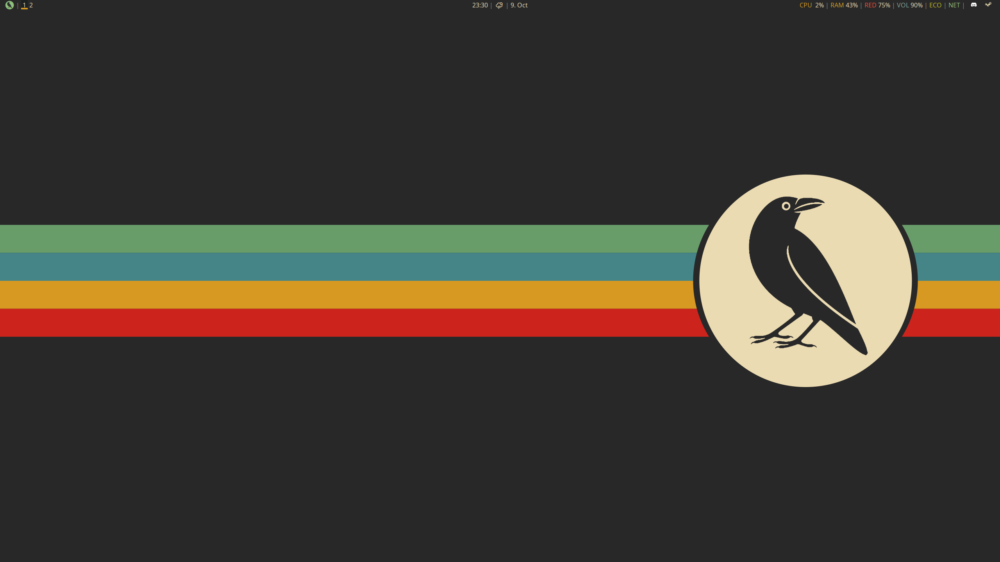
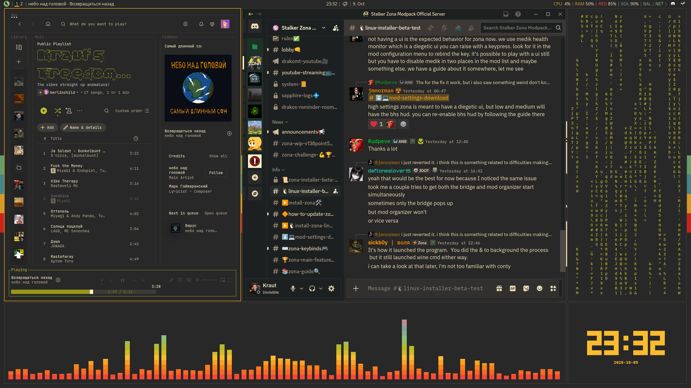

# CorvOS Desktop
### **An ultralight i3 based desktop environment, custom tailored to my personal styling tastes and maximum gaming performance while remaining suitable for daily use and productive workflow, using the Gruvbox color palette and custom panel modules.**

 

Blur? Overrated! Rounded corners? Childish! Animations? Waste of time!
This RICE is entirely focused on minimal system overhead and maximum performance while still looking incredibly sleek. *At least it does to my eyes*.

## Requirements

CorvOS Desktop is an i3-based desktop configuration for Linux. Most software dependencies are available from the distribution's standard repositories. The CorvOS repository includes its custom scripts, themes and selected assets.

**Core desktop components**

- **i3**: *tiling window manager*
- **Polybar**: *status bar and custom widgets*
- **Rofi**: *application launcher and menus*
- **Picom**: *window compositor*
- **Dunst**: *desktop notifications*
- **Kitty**: *terminal emulator*
- **btop**: *system resource monitor*
- **xsettingsd**: *desktop settings integration*
- **dex**: *XDG application autostart*
- **ZEN**: *a little peace of mind on demand*

**Fonts and visual assets**

- **Noto Sans**: *UI font I personally use and recommend as it's one of my favorites*. Install `fonts-noto-core` on Debian-based systems or `noto-fonts` on Arch-based systems.
- **CorvOS bird font**: *a personalized icon included in the repository*
- **Weather Icons**: *weather glyph font, included with its licence*
- **Gruvbox Plus icon theme**: *optional Rofi application icons*. On Arch-based systems, install [gruvbox-plus-icon-theme from the AUR](https://aur.archlinux.org/packages/gruvbox-plus-icon-theme). On Debian-based systems, download it from the [upstream releases](https://github.com/SylEleuth/gruvbox-plus-icon-pack/releases) and install it in `~/.local/share/icons/`.

See [Third-party assets and licences](docs/ASSET-SOURCES.md) for additional details.

**Optional widget dependencies**

Install these if you intend to use the related features.
Your distro will likely have most of these by default.

- **QRedshift**: *screen colour temperature and brightness controls*. Available from the [AUR](https://aur.archlinux.org/packages/qredshift) or the [upstream GitHub releases](https://github.com/raphaelquintao/QRedshift/releases).
- **Power Profiles Daemon**: *ECO, balanced and performance profile switching*. Package name: `power-profiles-daemon`.
- **PulseAudio utilities or compatible PipeWire integration**: *audio controls*. Provides `pactl` and related audio commands.
- **playerctl**: *media playback controls*
- **brightnessctl**: *brightness key bindings*
- **FFmpeg**: *PDA notification sound playback through `ffplay`*
- **libnotify**: *timer completion notifications through `notify-send` for the custom polybar timer widget*
- **Python 3**: *weather and Zen utilities*
- **iproute2**: *network route detection for the NET indicator*

**Linux Mint and Cinnamon integration**

The reference i3 configuration includes Cinnamon screensaver and settings commands, as well as the MATE PolicyKit authentication agent. These are specific to my system setup and I recommend sourcing your own equivalent utilities if you are not also using Mint.

**Network and weather**

The weather widget uses Open-Meteo and requires an internet connection. Its coordinates, display label and timezone can be overridden through environment variables.

The NET indicator checks for a default network route. It works independently of whether the connection uses Ethernet, Wi-Fi or USB tethering, but a route alone does not guarantee that an internet destination is reachable.

**Installation**

CorvOS is still being prepared for portable installation. A guided installer with component selection, dependency checks and backup support is planned. Existing configuration files should be backed up before manually installing or replacing them. A simple manual installation guide is in **/docs/INSTALLATION.md**

If you break something, please don't sue me, I barely know what I am doing :)
